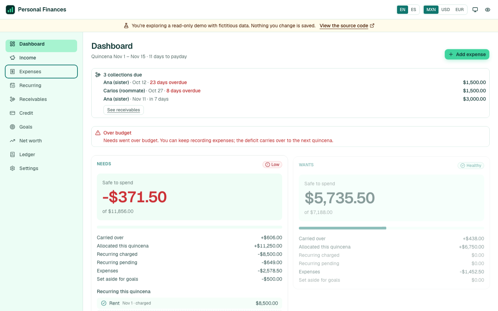
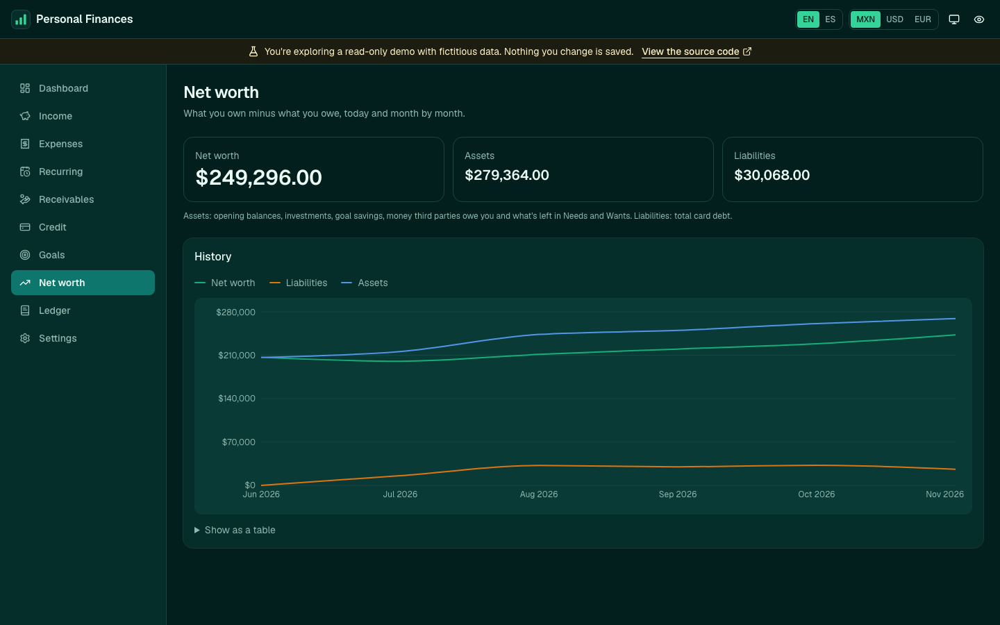
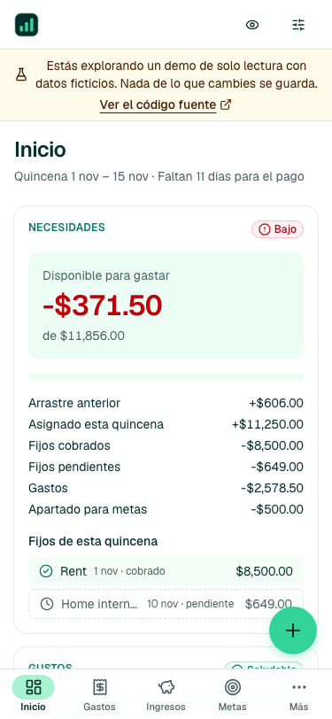
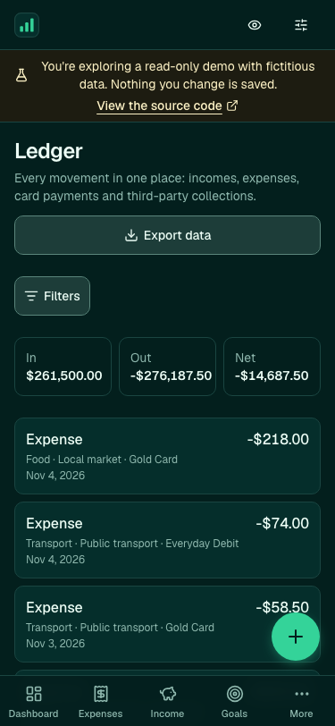

# Personal Finances

A personal finance app built around the Mexican **quincena** (paid on the 15th and the last day of
the month; the English UI calls it a **pay period**): every income is split automatically by your
rules into **Needs / Wants / Investment**, and the dashboard tells you how much is **safe to spend** in each bucket until the next payday.

It's my day-to-day money tool and a portfolio project. It is designed, specified and tested end to
end with **Spec-Driven Development** (GitHub Spec Kit + Claude Code), and it runs at **zero cost**
(Vercel Hobby + Supabase Free).

- **Live demo (read-only, no sign-in):** https://personal-finances-demo.vercel.app — fictitious
  balances and movements on example accounts at well-known Mexican banks (BBVA, Nu, Amex, GBM,
  Finsus), with short merchant-style expense names and budgets that stay in the green.
- **Specs (spec, plan, tasks):** [core](specs/_archive/001-personal-finances-core/) ·
  [Google sign-in](specs/_archive/002-google-sign-in/) · [UI refresh](specs/_archive/003-ui-refresh/) ·
  [taxonomy & icons](specs/_archive/004-taxonomy-income-icons/) · [quick expenses](specs/005-quick-expenses/) ·
  [card statement dates](specs/007-card-statement-dates/) · [navigation](specs/008-navigation-shell/) ·
  [low-friction flows](specs/009-low-friction-flows/) · [motion](specs/010-motion-polish/) — UX summary in
  [`docs/ux-roadmap.md`](docs/ux-roadmap.md)

| Desktop · light                                                         | Desktop · dark                                                        |
| ----------------------------------------------------------------------- | --------------------------------------------------------------------- |
|  |  |

| Mobile · light                                                                                              | Mobile · dark                                                                                                |
| ----------------------------------------------------------------------------------------------------------- | ------------------------------------------------------------------------------------------------------------ |
|  |  |

## What it does

| Area                     | Highlights                                                                                                                                                                                                                                                         |
| ------------------------ | ------------------------------------------------------------------------------------------------------------------------------------------------------------------------------------------------------------------------------------------------------------------ |
| Income & rules           | Versioned distribution rules (e.g. 50/30/20 with Investment sub-rules); exact splits in integer cents, largest-remainder rounding, funded quincena chosen per income. Every income has a type (salary, gift, cashback, sales…), exported in the CSV.               |
| Safe-to-Spend            | Per-bucket balance with carry-over between quincenas, a traffic light (never color alone) and days to payday. Recurring charges are reserved from day 1 of the quincena. The headline never goes negative: an overspent bucket shows $0 and how much it went over. |
| Expenses & cards         | One-tap expenses that inherit the bucket from their subcategory; credit cards in "totalero" mode: the headline is always the **amount to pay to avoid interest**, never the minimum. Accounts show their bank's logo.                                              |
| Categories               | A ready-made taxonomy of 26 categories (13 Needs, 13 Wants) with Lucide icons; each category's icon can be changed and subcategories inherit it unless they get their own.                                                                                         |
| Third parties (MSI)      | Interest-free installment purchases made for someone else: collection calendar ahead of the card's due date, kept out of personal metrics.                                                                                                                         |
| Credit, goals, net worth | Timeline of paydays × card due dates × collections; emergency fund (months of vital expenses) and sinking funds; monthly net-worth history.                                                                                                                        |
| Ledger & export          | Every movement, filterable; CSV of the (filtered) ledger or a full ZIP backup (one CSV per table) generated in the browser.                                                                                                                                        |
| Everywhere               | English/Spanish switch in place, MXN/USD/EUR display (data stays in MXN), privacy mode that masks every amount (charts included), cold-start and offline handling.                                                                                                 |

## Architecture

```
Browser (Next.js App Router, all derived values computed client-side)
 ├─ src/domain/      pure TypeScript: money, quincenas, splitter, safe-to-spend, credit, goals…
 ├─ src/features/    screens + hooks (TanStack Query single snapshot cache, optimistic writes)
 ├─ src/components/  <Money> (the only amount renderer: currency + privacy), charts, layout
 └─ src/data/        DataProvider contract
       ├─ supabase/  real app: Postgres + RLS, atomic RPCs (validate & insert, no business logic)
       └─ mock/      public demo: in-memory, read-only, never imports Supabase
```

- **Two deployments, one codebase.** `NEXT_PUBLIC_DEMO_MODE` is a build-time constant: the demo
  build contains no Supabase code or keys (checked in CI by `pnpm check:demo-bundle`).
- **Zero cost by design.** No server cron, queues or file storage: recurring charges, goal
  contributions and the monthly net-worth snapshot are written idempotently when the app opens.
- **Security.** Row Level Security on every table, composite foreign keys `(user_id, id)` so no row
  can reference another user's data, sign-ups disabled, only the publishable key in the client.
- **Sign-in.** Password, or the owner's Google account (OAuth + PKCE, code exchanged on the server,
  linked to the existing user by verified email). Any other Google account is rejected because
  sign-ups stay disabled — see [`specs/_archive/002-google-sign-in`](specs/_archive/002-google-sign-in/spec.md).
- **Privacy.** No analytics or telemetry. The only external call is the public FX rate API, with
  no user data.

## Design

"Fresh & Growth" identity ([`specs/_archive/003-ui-refresh`](specs/_archive/003-ui-refresh/spec.md)):

- **Palette in one place.** Ink `#052E2B`, teal `#0F766E`, emerald `#34D399`, mint `#A7F3D0` and mist `#ECFDF5`
  for the light and dark themes, plus an "Asphalt & Neon" theme (near-black `#0A0A0A` with acid lime `#CEE616`),
  all as brand primitives in [`src/styles/tokens.css`](src/styles/tokens.css) mapped to semantic tokens. A unit
  test reads that file and fails if any text/background pair drops below WCAG AA (4.5:1) or any indicator below
  3:1 — in all three themes. Emerald is never used as text on light surfaces.
- **Neon (default) / Light / Dark / System.** Stored with the other device preferences and applied by an inline
  script before the first paint, so a reload never flashes the wrong theme; "System" follows the OS live. Brand
  surfaces such as the demo notice use the primary token, so they follow the theme (lime with near-black text in neon).
- **Mobile first.** Bottom bar `Dashboard · Expenses · ＋ · Credit · More` (＋ opens a sheet with expense, income, card
  payment and quick expenses), forms as bottom sheets with the numeric keyboard, ledger as cards, 44 px touch
  targets, no horizontal scroll from 320 px.
- **Motion that respects you.** Short (≤ 300 ms) transitions on opacity/transform only: a page-in fade when
  navigating (the header and bottom bar never move), new rows sliding in and deleted ones fading out, a sliding
  nav indicator (Framer Motion, loaded after hydration) — and none of it with "reduce motion" on. No amount is
  ever animated, and with privacy mode on, amount fields blur instantly.
- **Brand icons and manifest** (installable on a phone), generated by `scripts/generate-favicon.mjs`.

## Stack

Next.js 16 (App Router, Turbopack) · React 19 · TypeScript (strict) · Tailwind CSS 4 + shadcn/ui ·
TanStack Query · Zustand · next-intl · Zod + React Hook Form · Recharts · Supabase (Postgres 17) ·
Vitest + fast-check · Playwright + axe-core · pgTAP.

## Run it

Requirements: Node.js 22, pnpm, and Docker for the local database.

```bash
pnpm install

# Demo mode — no database needed
pnpm dev:demo                                  # http://localhost:3000

# Personal mode against a LOCAL Supabase
pnpm db:start                                  # prints the local URL and publishable key
pnpm db:reset                                  # applies supabase/migrations
cp .env.example .env.local                     # fill NEXT_PUBLIC_SUPABASE_URL / _PUBLISHABLE_KEY
# create your user in Studio (http://localhost:54323) — sign-ups are disabled
pnpm dev
```

Deploying the two Vercel projects and the Supabase cloud project: [`docs/deploy.md`](docs/deploy.md).

## Quality gates

| Command                                              | What it checks                                                                                                                                                                                                                                          |
| ---------------------------------------------------- | ------------------------------------------------------------------------------------------------------------------------------------------------------------------------------------------------------------------------------------------------------- |
| `pnpm typecheck` · `pnpm lint` · `pnpm format:check` | strict TS, no `any`, Supabase imports only in `src/data/supabase`, no hard-coded UI text, no amounts formatted outside `<Money>`                                                                                                                        |
| `pnpm test`                                          | domain (incl. property-based tests), hooks, i18n parity, theme contrast (WCAG AA, all three themes), performance budgets (Safe-to-Spend < 50 ms and full export < 10 s with 5 years of data)                                                            |
| `pnpm test:contract:local`                           | the same DataProvider contract against the Mock and a local Supabase                                                                                                                                                                                    |
| `pnpm db:test`                                       | pgTAP: RLS isolation between users, exact-sum invariants, account deletion                                                                                                                                                                              |
| `pnpm test:e2e:local`                                | Playwright matrix demo/live × EN/ES: P1 flows, toggles, privacy sweep, read-only demo with zero Supabase requests, cold start/offline, accessibility (axe, light/dark/neon/mobile), theme, mobile layout, reduced motion, perceived-performance budgets |
| `pnpm check:demo-bundle` · `pnpm check:no-uploads`   | demo bundle isolation; no file uploads anywhere                                                                                                                                                                                                         |

Local Supabase is used **only** for development and tests; the tests refuse to run against any
non-local database.

## Project structure

```
specs/              one folder per feature (spec, plan, research, data model, contracts, tasks, quickstart);
                    finished ones live in specs/_archive/
src/app/            routes ((app) area: dashboard, income, expenses, recurring, receivables,
                    credit, goals, net-worth, ledger, settings/…)
src/domain/         pure business logic, no I/O, no clock
src/data/           DataProvider, Supabase and Mock implementations, snapshot cache, background sync
src/features/       one folder per feature (screens, hooks, Zod schemas)
src/i18n/           EN/ES dictionaries and the only place that formats numbers and dates
supabase/           migrations (schema, invariants, RPCs, view, RLS, indexes) and pgTAP tests
tests/              unit, contract and e2e suites
scripts/            CI checks (demo bundle, no uploads) and the local-Supabase test runner
```

## Key decisions

The reasoning lives next to the code: [`plan.md`](specs/_archive/001-personal-finances-core/plan.md)
(constitution check, final verification and recorded deviations),
[`research.md`](specs/_archive/001-personal-finances-core/research.md) (alternatives considered) and
[`data-model.md`](specs/_archive/001-personal-finances-core/data-model.md) (formulas). A few of them:

- Money is always integer **cents** (`Cents` branded type) and percentages are **basis points**;
  no floating point touches an amount.
- One coherent **snapshot** of the user's data in the client cache: every screen is a pure
  selector over it, so a write updates the whole app at once (optimistic, with rollback).
- The demo is a **separate provider**, not a flag in the UI: screens ask `capabilities.canWrite`,
  and a shared contract suite keeps the Mock and Supabase behaving the same.
